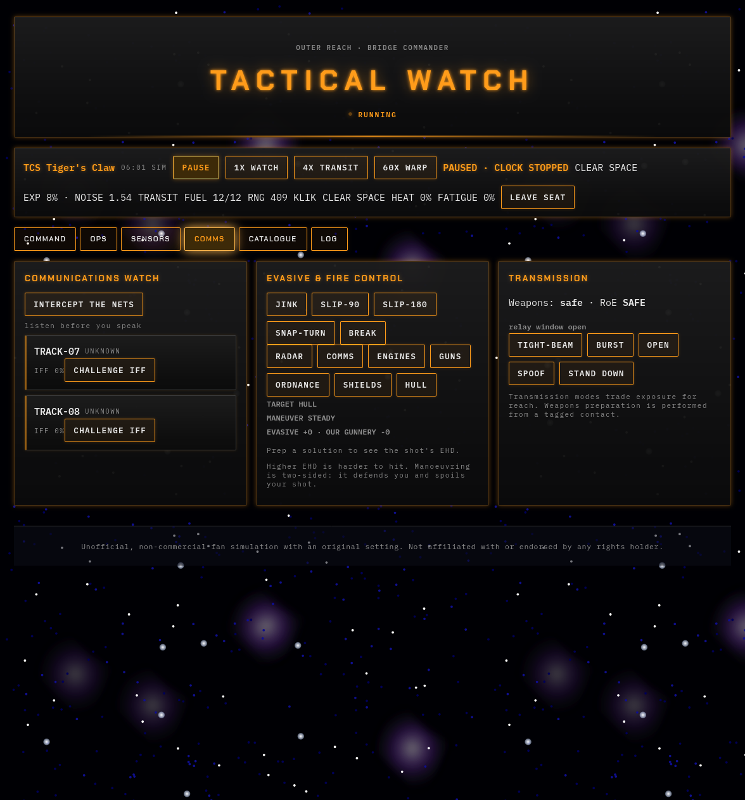
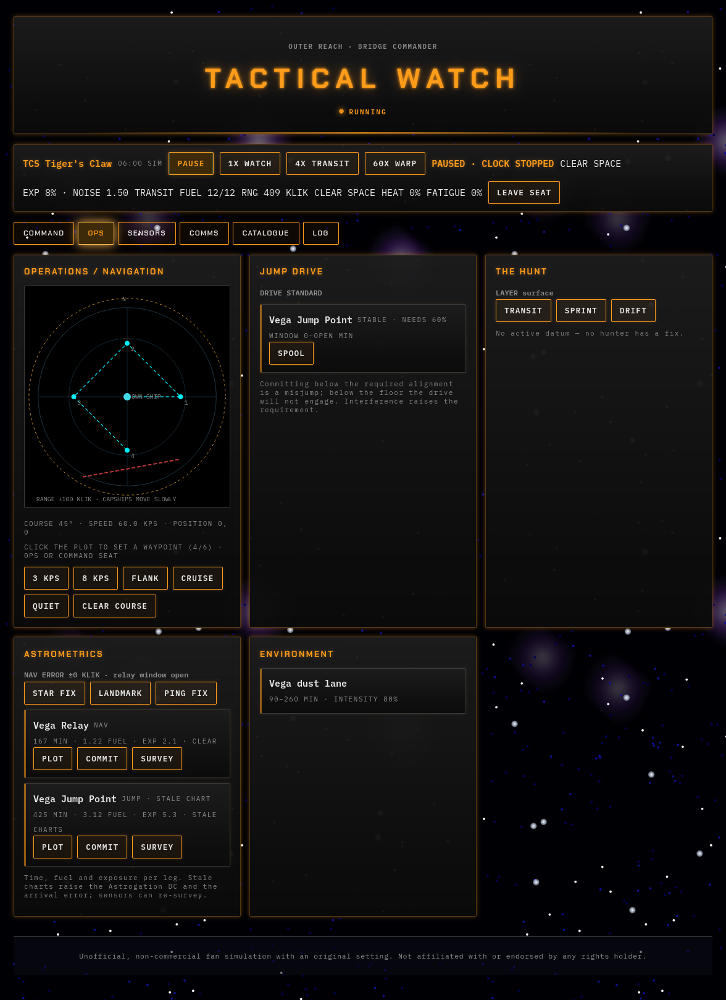
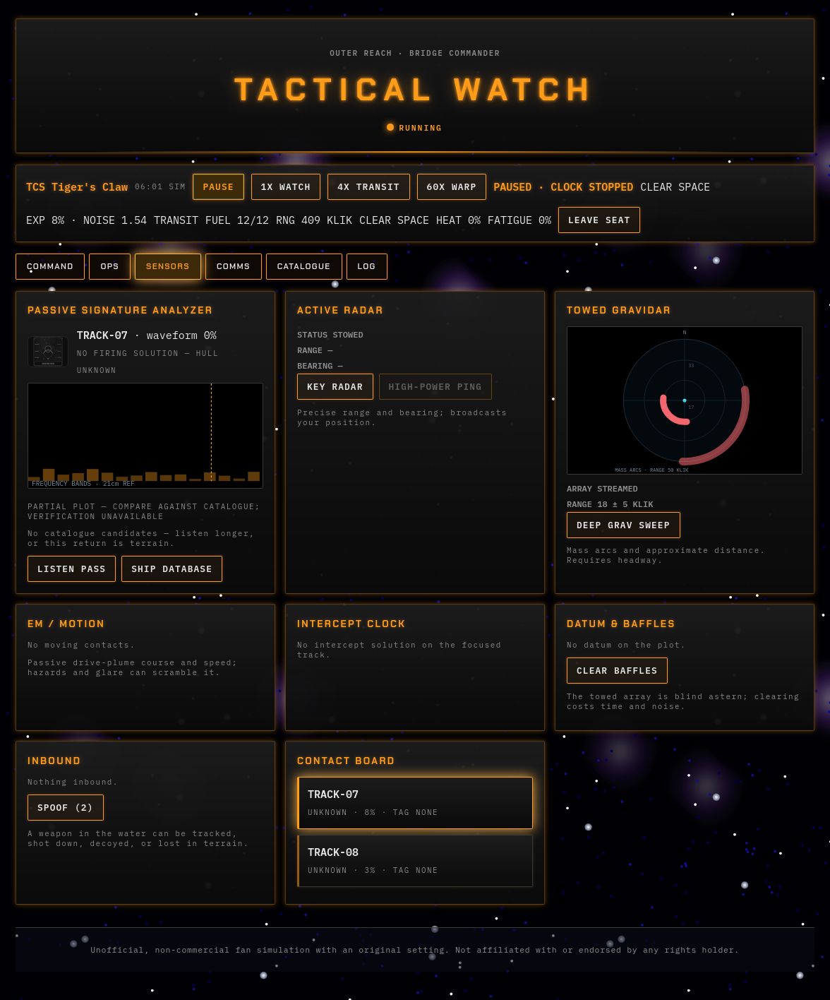
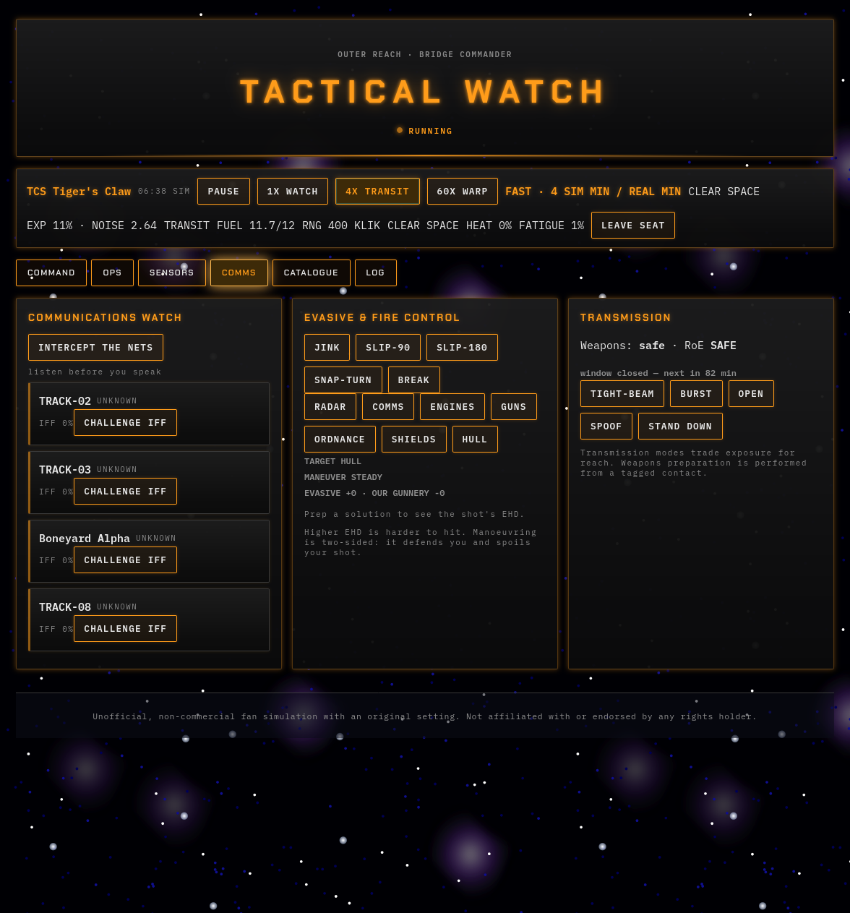
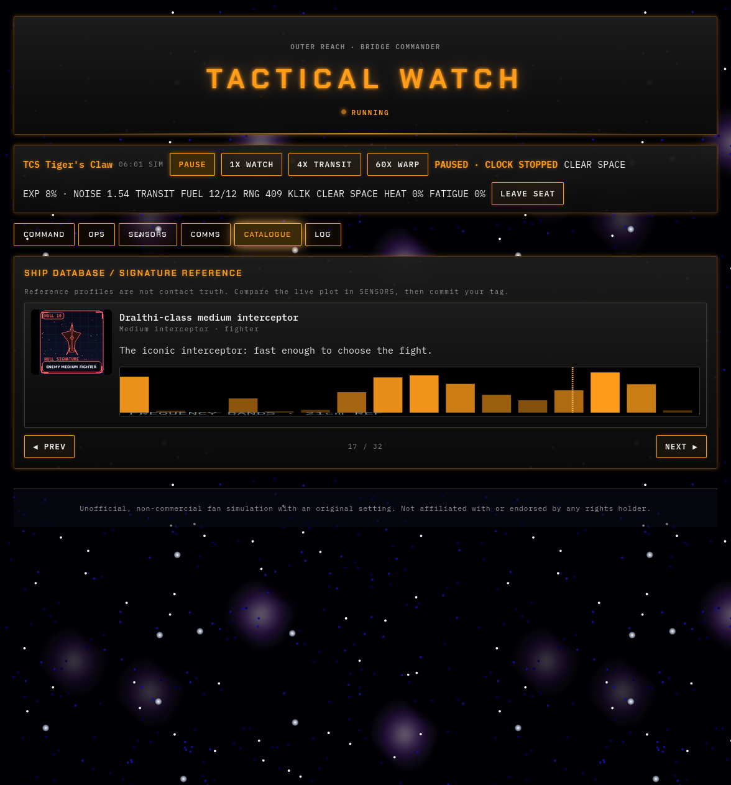
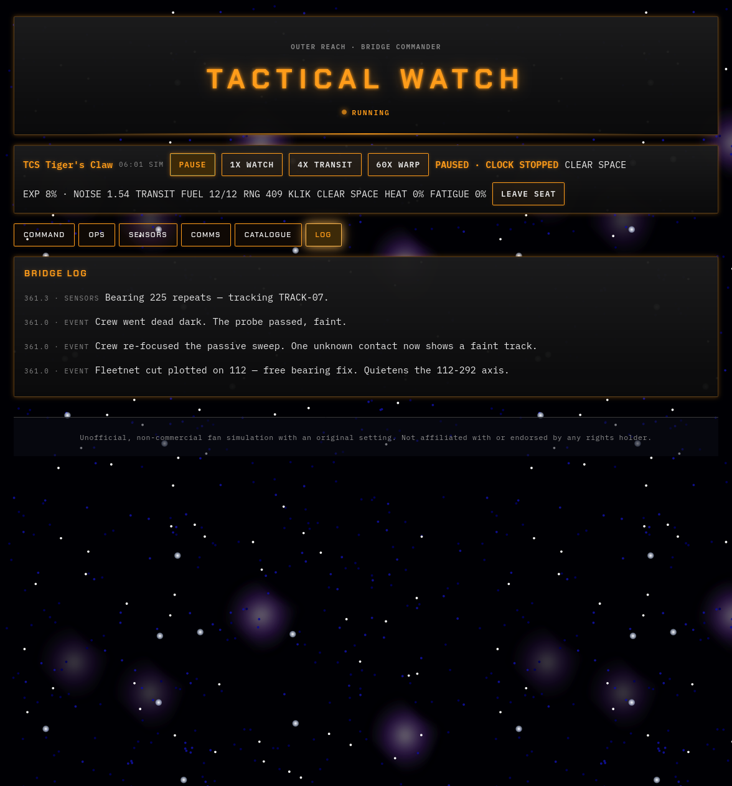
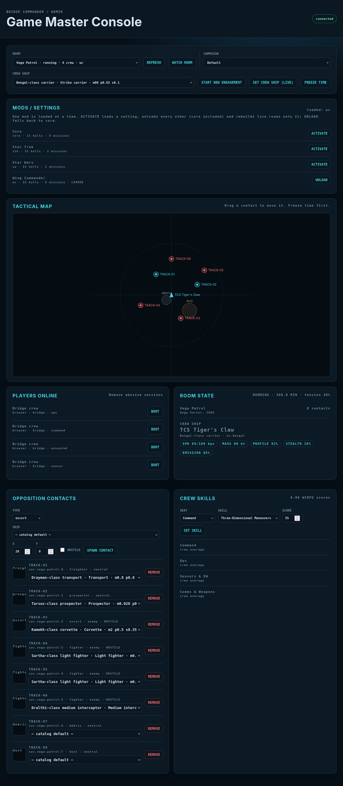

# BRIDGE COMMANDER

**Five players. One ship. Nobody wins alone.**

A standalone, browser-based tabletop bridge simulator. Players share a ship, detect and classify contacts, manage the watch, and pause for tabletop handoffs while a server-authoritative hostile force reacts.

The setting and hull catalogue are original to this project and use role-bearing, faction-neutral class names (`Friendly_Cruiser`, `Enemy_Destroyer`, …), so the same mechanics can be re-flavoured. The simulation rules are ported from WCRPG; see [Credits and licensing](bridge/CREDITS.md).


## Your crew

Every seat holds information the others need. Talking to each other isn't optional.

| Seat | Role | You are responsible for |
|------|------|-------------------------|
| **Captain (CO)** | Command | Controlling time and making fleet-level decisions |
| **Ops (XO)** | Helm | Navigation and speed |
| **Sensors** | Science | Working out what the enemy is and where it's hiding |
| **Comms** | Signals | Classifying contacts as friend or foe |
| **Catalogue** | Records | Identifying the signals Sensors picks up |

| | |
|---|---|
|  |  |
|  |  |
|  |  |

## How a contact flows through the ship

Sensors detects a signal → Catalogue identifies it → Comms classifies it as friend or foe → the Captain decides → Ops moves the ship.
Miss a link in the chain and the enemy gets the first move.

## After-action review

When the mission ends, the log lets the crew replay their decisions and see where the chain broke down, so the next watch goes better.

## The Game Master

The game master is the one orchestrating the scenario. They have their own admin panel on port `8788` by default. 

This repository is an unofficial, non-commercial fan project. It is not affiliated with or endorsed by the rights holders. See [Credits and licensing](bridge/CREDITS.md).

## Quick start

Python 3.12 or newer is required.

```bash
python -m venv .venv
. .venv/bin/activate
python -m pip install -e ".[dev]"
python -m bridge
```

Open <http://localhost:8787>. The player WebSocket is available at `/ws`.

For a runtime-only installation:

```bash
python -m pip install .
bridge
```

## Features

- Four cooperative bridge stations: Command, Ops, Sensors/[EW](https://en.wikipedia.org/wiki/Electronic_warfare), and Comms/Weapons
- Server-authoritative pause, 1x, 4x, warp, and manual time controls
- [Passive](https://en.wikipedia.org/wiki/Passive_radar), active-[radar](https://en.wikipedia.org/wiki/Radar), gravidar, [EM](https://en.wikipedia.org/wiki/Electromagnetic_radiation), [buoy](https://en.wikipedia.org/wiki/Sonobuoy), [IFF](https://en.wikipedia.org/wiki/Identification_friend_or_foe), [TMA](https://en.wikipedia.org/wiki/Target_motion_analysis), and datum mechanics
- Fuel, navigation, jumps, heat, fatigue, environments, [maintenance](https://en.wikipedia.org/wiki/Maintenance_(technical)), and ship systems
- Decision events, hostile escalation, career progression, and tabletop handoff packs
- Fifteen hulls, arc-coded hardpoints, modules, weapons, campaign events, hazards, and nav charts
- Bundled player UI and GM console with no frontend build step
- Package-local catalogs and distinct 128×128 placeholder artwork

## Configuration

Copy values from `bridge/.env.example` into a local `.env` or export them in the environment.

| Variable | Default | Purpose |
|---|---|---|
| `HOST` | `127.0.0.1` | Player server bind address |
| `PORT` | `8787` | Player server port |
| `ADMIN_HOST` | `127.0.0.1` | GM console bind address |
| `ADMIN_PORT` | unset | Enables the GM console when set |
| `ADMIN_TOKEN` | unset | Required whenever `ADMIN_PORT` is set |
| `DATA_DIR` | `./data` | SQLite room storage |
| `ACTIVITY_DIST` | packaged UI | Optional external activity bundle |
| `ASSET_DIR` | packaged art | Optional external image tree |
| `CORS_ORIGINS` | `*` | Allowed browser origins |
| `ADMIN_ORIGINS` | `*` | Allowed GM-console origins |

The server intentionally binds to loopback by default. Player rooms do not provide their own authentication layer, so do not set `HOST=0.0.0.0` on an untrusted network without placing the service behind suitable access control.

## Verification

```bash
python -m pytest
ruff check bridge tests
mypy bridge
node --check bridge/activity/dist/activity.js
node --check bridge/server/admin-ui/admin.js
python -m build
```

The test suite covers shared models and deterministic helpers, campaign data, the simulation engine, WebSocket permissions, public-state redaction, persistence, the GM console, static assets, and packaging paths.

## Project layout

```text
bridge/
  activity/dist/  player browser UI
  img/            128×128 placeholder action, VDU, and terrain art
  resources/      campaigns, events, hazards, environments, hulls, and modules
  server/         FastAPI, WebSocket, persistence, simulation, and GM console
  shared/         protocol, models, catalogs, events, and simulation helpers
tests/            unit, integration, protocol, and server tests
pyproject.toml    package metadata and development tooling
```

## Documentation

- [Detailed project guide](bridge/README.md)
- [Player watch manual](bridge/MANUAL.md)
- [Roadmap](bridge/ROADMAP.md)
- [Credits and licensing](bridge/CREDITS.md)

The activity and GM console are plain static JavaScript bundles. Edit their files under `bridge/activity/dist/` and `bridge/server/admin-ui/` directly; no frontend build step is required.
